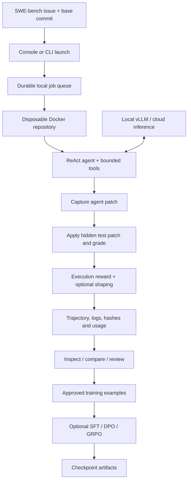

# SWE-RL Console · Code Repair with Execution-Grounded RL

**Investigate a real issue. Generate a patch. Run the tests. Keep the evidence.**

[](https://github.com/jeevanu345/Code-Repair-Agent-with-Execution-Grounded-RL-on-SWE-Bench/actions/workflows/ci.yml)


A software repair research system that connects **SWE-bench issues**, a tool-using
LLM agent, isolated Docker execution, recorded test outcomes, and optional
**SFT / DPO / GRPO** training. Its local web console brings run launch, live events,
experiments, patch inspection, evaluation, training controls, and artifacts into
one workspace.

The success signal comes from executing tests in the target repository.
Model confidence and a plausible-looking diff are not evidence of resolution.

> **Current scope:** an operational local research console. No published SWE-bench
> score is claimed. Real Docker grading, provider generation, and GPU training
> need validation with your configured services and hardware.

**Start here:** [Quickstart](#quickstart) · [UI tour](#ui-tour) ·
[Complete project guide](Everything_about_project.md) ·
[Control center reference](swe-rl-agent/docs/control-center.md)

## Contents

- [What you can do](#what-you-can-do)
- [How a repair works](#how-a-repair-works)
- [Quickstart](#quickstart)
- [Your first repair run](#your-first-repair-run)
- [UI tour](#ui-tour)
- [Agent tools and strategies](#agent-tools-and-strategies)
- [Evaluation and experiment comparison](#evaluation-and-experiment-comparison)
- [Rewards and training](#rewards-and-training)
- [Model connections and credentials](#model-connections-and-credentials)
- [Configuration](#configuration)
- [Storage and provenance](#storage-and-provenance)
- [Repository map](#repository-map)
- [Developer commands](#developer-commands)
- [Troubleshooting](#troubleshooting)
- [Scope and limitations](#scope-and-limitations)
- [Documentation](#documentation)

## What you can do

| Goal | What the project provides |
|---|---|
| Repair a SWE-bench issue | A bounded ReAct loop that reads, searches, edits and tests a repository in Docker. |
| Observe execution | Persisted live events, tool outputs, usage, tests, rewards and failure evidence. |
| Manage work | A durable local queue, two subprocess worker slots, priority and lifecycle controls. |
| Study a patch | A three-pane inspector with a file tree, unified/split diffs, conversations and test logs. |
| Compare approaches | Versioned experiment configurations, matched issue cohorts and qualified pass@k estimates. |
| Generate alternatives | Independent seeded candidates, execution/minimal/regression/majority selection and explicit critic review. |
| Prepare training data | Human annotations, approval/rejection, reviewed SFT exports and paired DPO examples. |
| Train local weights | Guarded SFT, DPO and GRPO paths with callback metrics and checkpoint artifacts. |
| Connect a model | Local vLLM or supported cloud providers, model discovery, completion checks and opt-in fallback. |
| Inspect infrastructure | Measured service probes, queue state, workers, artifacts and available GPU telemetry. |

## How a repair works



1. Load the issue and its repository identity from the chosen dataset revision.
2. Check out the base commit and prepare dependencies in an ephemeral container.
3. Let the model inspect and modify code through resource- and budget-bounded tools.
4. Capture the patch **before** applying the hidden evaluation test patch.
5. Execute fail-to-pass and pass-to-pass tests; record outcomes and logs.
6. Preserve the patch, messages, tools, usage, rewards and configuration for review.

**Fail-to-pass (F2P)** tests identify behavior the patch must fix.
**Pass-to-pass (P2P)** tests check behavior that must remain working. Resolution
requires the requested F2P tests to pass and P2P tests to stay passing, with
nonempty F2P evidence and no grading timeout. Setup/patch/agent failures are
handled as failures by the rollout.

## Quickstart

The Python application lives in **`swe-rl-agent/`**. Run application commands there.

### Path A — open the console

This installs the lightweight UI/API dependencies. It does not install the ML
frameworks or make a model call.

```bash
git clone https://github.com/jeevanu345/Code-Repair-Agent-with-Execution-Grounded-RL-on-SWE-Bench.git
cd Code-Repair-Agent-with-Execution-Grounded-RL-on-SWE-Bench/swe-rl-agent

python3 -m venv .venv-dashboard
.venv-dashboard/bin/python -m pip install -r requirements-dashboard.txt

PYTHONPATH=src .venv-dashboard/bin/python -m uvicorn swe_rl.dashboard.app:app \
  --host 127.0.0.1 --port 8088
```

Open **[http://127.0.0.1:8088](http://127.0.0.1:8088)**.
The API reference is at **[http://127.0.0.1:8088/api/docs](http://127.0.0.1:8088/api/docs)**.
An empty workspace shows empty states; the interface does not invent demo scores.

### Path B — execute repair and evaluation workloads

Use **Python 3.11–3.12**, a running Docker daemon and access to the datasets and
chosen model. Full training/serving dependencies may require a prepared Linux/GPU
host; the console itself can run separately with Path A.

```bash
# From swe-rl-agent/
python3.11 -m venv .venv
source .venv/bin/activate
python -m pip install -e '.[dev]'
cp .env.example .env

make build-sandbox

# Optional development persistence services
make services-up
make migrate

python -m swe_rl.cli dashboard
```

Configure **Model Connections** before launching a run. A local inference example
on a compatible GPU host is:

```bash
vllm serve Qwen/Qwen2.5-Coder-14B-Instruct --api-key local-dev
```

The model identifier entered in the console must be served by the selected
endpoint. PostgreSQL/MinIO are optional persistence integrations; Redis is not the
local job queue broker. The console's launch forms require the full workload
dependencies in the **same Python environment that starts its workers**.

### Prerequisites at a glance

| Operation | Requirements |
|---|---|
| Browse the console | Lightweight dashboard dependencies; output files for historical evidence. |
| Save provider credentials | A supported OS keyring backend. Environment keys are an alternative. |
| Execute a repair | Full package, Docker sandbox image/daemon, dataset access and model inference. |
| Run official grading | Compatible SWE-bench harness, Docker and required benchmark environments. |
| Train weights | Full ML stack, accessible weights, suitable GPU hardware and explicit training opt-in. |

## Your first repair run

1. Open **Model Connections** and choose a provider, model and endpoint. Save your
   connection; use **Fetch models** or **Test connection** when you want to contact
   the provider. A completion test may incur a charge.
2. Open **New Run**. Select a dataset/revision and a valid instance ID from the
   **Dataset Browser**.
3. Set strategy, sampling/seed, step/test/cost limits and sandbox resources.
   Start with one candidate before larger comparisons.
4. Launch and follow the run in **Runs**. The live stream exposes state changes
   and recorded execution evidence.
5. Inspect the patch, F2P/P2P results, tool trace and cost/reward components.
6. Annotate the trajectory and approve/reject it for a reviewed training export.

Equivalent single-issue CLI entry points, after configuring inference:

```bash
python -m swe_rl.cli rollout one django__django-11099 \
  --strategy minimal-patch --max-steps 30 --test-budget 5

python -m swe_rl.cli rollout candidates django__django-11099 \
  --count 4 --workers 2 --selection regression-safe
```

Use an instance present in your chosen dataset; the issue above illustrates the
command shape, rather than promising a successful model repair.

## UI tour

| Area | Screens and useful controls |
|---|---|
| Overview | Recorded outcomes, token/cost/runtime summaries, charts, recent work and measured service health. |
| Agent | New Run, searchable Runs, saved views, Experiments and matched Compare cohorts. |
| Benchmarks | SWE-bench instance selection, evaluation launch/status and report artifacts. |
| Training | SFT/DPO/GRPO jobs, callback metrics, checkpoints, Replay Buffer review and Reward Analysis. |
| Models | Provider connections, repair suggestions, capability/pricing registry, fallback and prompt versions. |
| System | Infrastructure, queue/workers, artifact previews/downloads, dataset slices, settings and API reference. |

### Run inspector

- **Patch:** file tree, unified/split comparison and whitespace filtering.
- **Trace:** tool name, arguments, output, duration and status.
- **Tests:** F2P/P2P results and captured final grading logs.
- **Conversation/context:** recorded assistant/tool messages and repository evidence.
- **Costs/rewards/failures:** recorded usage, component breakdowns and evidence-based failure categories.
- **Export:** JSON and associated artifacts with provenance.

### Execution controls

```text
queued → preparing → running → testing/evaluating → completed
                       └────────────────────────→ failed / cancelled
```

Pause/resume operate at cooperative runtime boundaries. Cancel requests
termination; stop-and-evaluate requests grading of the current patch during
eligible preparation/agent phases. Retry creates another attempt; requeue and
priority controls manage eligible jobs. Blocking external calls do not become
instantaneously pausable.

The UI includes light/dark themes, custom in-app dropdowns across static and
dynamic forms, keyboard navigation, type-to-find options, command palette,
global search and saved views. Dropdown selections preserve the existing form
values and event handlers. See the [full UI reference](swe-rl-agent/docs/control-center.md)
for every screen and action.

## Agent tools and strategies

| Tool | Purpose |
|---|---|
| `bash` | Run a bounded container command subject to command checks. |
| `file_read` / `file_write` / `file_edit` | Inspect and modify repository files. |
| `grep` / `repo_map` | Locate relevant source and build a compact file map. |
| `test_run` | Run selected tests within the agent's test budget. |
| `repository_graph` | Inspect bounded Python AST symbols, imports and static call references; recommend related tests. |
| `semantic_code_search` | Rank Python symbols/docstrings/source using conceptual text relevance and explicit matching evidence. |
| `git_history` | Retrieve recent commits and patches affecting a relative path. |
| `symbol_edit` | Replace a unique Python symbol after validating the resulting AST. |
| `finish` | End agent generation; the worker still captures and grades the patch. |

Profiles include **standard**, **plan-execute**, **test-driven**, **minimal-patch**,
**high-exploration**, **low-cost** and **explorer-reviewer**. Custom prompt versions
are immutable and hashed. Reflection and context compression are recorded;
repeated actions/failures can trigger reflection. Test budgets are enforced.

Explorer → implementer → reviewer is a staged strategy using the selected model,
with recorded role transitions. Repository analysis is bounded static Python
analysis; semantic search uses deterministic concept/text scoring, without
embeddings. An optional hunk minimizer removes unnecessary changes only when
bounded regrading preserves the successful outcome.

## Evaluation and experiment comparison

Automatic prediction generation supports **Lite / Verified / Full**, bounded
parallelism and multiple candidates. Imported predictions can be submitted to
the official harness for supported multilingual/multimodal variants; this does
not implement image-aware or language-specific automatic repair.

```bash
# Small evaluation on the already configured/served model
python -m swe_rl.cli eval lite \
  --subset lite --max-instances 20 --parallelism 4 --run-id first-eval
```

Prediction files and rendered reports are saved under the configured output
paths. `make eval SUBSET=verified` uses the evaluation script; its default cap is
300 instances. `CHECKPOINT` selects a model identity **already served** by your
endpoint; it does not start or reload the serving process.

Experiment snapshots preserve model/provider/checkpoint, strategy/prompt version,
dataset/revision, sampling, budgets, sandbox limits and reward mix. Comparison
shows matched issues and the **only A / only B / both / neither** cohorts.

Pass@k uses the estimator `1 - C(n-c,k) / C(n,k)` only for eligible groups with at
least k candidates. Grading-informed candidate selection is labeled separately
from official pass@1. Failed attempts count in repair analytics; training and
evaluation jobs are excluded. Missing cost measurements remain unknown.

## Rewards and training

Execution reward is computed from recorded test outcomes. Shaped reward exposes
partial test rates and patch/lint/empty/timeout penalties. Optional PRM scoring
is explicitly configured and requires its own judge availability.

```text
recorded reward = execution_weight × execution_reward
                + shaped_weight × shaped_reward
                + prm_weight × process_reward
```

Normal rollouts default to execution weight **1**, shaped weight **0**, PRM
weight **0**. Binary resolution is retained separately from blended rewards.
GRPO uses configured component weights and optimizer-step decay of the shaped
weight; its default decay horizon is 5,000 steps.

| Algorithm | Training input |
|---|---|
| SFT | Formatted HumanEvalPack or reviewed JSON/JSONL examples. |
| DPO | Preference examples with `prompt`, `chosen` and `rejected`. |
| GRPO | SWE-bench prompts; each generated patch is evaluated against its matching instance. |

The UI supports trajectory annotations and approval/rejection. Reviewed SFT
exports contain approved examples; DPO exports pair approved and rejected
patches from the same issue. Curriculum helpers use observed failure categories.

On a prepared GPU host only:

```bash
export SWE_RL_ALLOW_HEAVY_TRAINING=true
python -m swe_rl.cli train sft --output-dir outputs/sft
python -m swe_rl.cli train dpo outputs/control/exports/reviewed-dpo.jsonl
python -m swe_rl.cli train grpo --max-instances 50 --output-dir outputs/grpo
```

Use the actual exported DPO path. The console additionally requires the training
form's explicit opt-in. Trainer callbacks emit available metrics and checkpoint
events; absent metrics are not filled with synthetic values. Checkpoint actions
include evaluation, archive/restore and confirmed deletion. **Load** updates the
vLLM connection identity and reports that an external serving reload is required.

## Model connections and credentials

Supported adapters include **local vLLM, OpenAI, Anthropic/Claude, NVIDIA NIM,
Google/Gemini, Alibaba Cloud/Qwen, DeepSeek, Mistral, xAI/Grok, Groq, Together AI,
Fireworks AI, OpenRouter** and a **custom OpenAI-compatible endpoint**.

- Saved provider keys use an approved OS credential backend; local profiles store
  secret references. There is no plaintext fallback when a secure backend is absent.
- Environment-based credentials remain supported on headless hosts.
- API responses omit key values; browser local storage contains preferences,
  not provider keys.
- Model discovery and test completions are explicit provider requests.
- Fallback is opt-in for transient failures and records the actual provider/model.
- Capability and pricing registry values are user declarations; request telemetry
  is measured within the process, rather than an account-wide billing feed.

The repair suggestion assistant returns text; it does not execute that text.
Use **New Run** for execution-grounded repair. Cloud inference can generate
patches, but a cloud API key does not expose remote weights to local TRL training.
See [model connections](swe-rl-agent/docs/model-connections.md) for protocols and
configuration precedence.

## Configuration

Copy `swe-rl-agent/.env.example` to `.env` in the application directory.

| Concern | Important settings |
|---|---|
| Inference | `LLM_PROVIDER`, `LLM_MODEL`, `LLM_BASE_URL`, `LLM_API_KEY`, `LLM_PROFILE_PATH` |
| Local serving | `MODEL_NAME`, `MODEL_REVISION`, `VLLM_HOST`, `VLLM_PORT`, `VLLM_API_KEY` |
| Sandbox | `SANDBOX_IMAGE`, `SANDBOX_MEM_GB`, `SANDBOX_CPUS`, `SANDBOX_WALLCLOCK_S`, `SANDBOX_DISABLE_NETWORK_AFTER_INSTALL` |
| Artifacts | `TRAIN_OUTPUT_DIR` (default `./outputs`) |
| Persistence | `DATABASE_URL`, optional `CONTROL_DATABASE_URL`, `POSTGRES_*`, `MINIO_*`, `REDIS_URL` |
| Cost estimates | `MAX_DOLLARS_PER_RUN`, `DOLLAR_PER_1K_TOKENS_IN`, `DOLLAR_PER_1K_TOKENS_OUT` |
| Training | `SWE_RL_ALLOW_HEAVY_TRAINING`, `GRPO_GROUP_SIZE`, `GRPO_KL_COEF`, `GRPO_LR` |
| Observability | `LOG_LEVEL`, `LOG_DIR`, `PROMETHEUS_PORT`, `SENTRY_DSN`, `WANDB_*` |

Explicit inference configuration takes precedence over the saved connection,
which takes precedence over environment defaults. YAML presets are under
`configs/`; most CLI flows construct settings/dataclasses directly, so consult
the consuming entry point before assuming a YAML field overrides it.

Token prices must be configured for useful dollar estimates. A per-rollout cap
can stop future work after incurred usage; it cannot undo a billed completion
or guarantee a shared account-wide spending limit.

## Storage and provenance

| Store | What it contains |
|---|---|
| `outputs/control/control.sqlite3` | Local jobs, experiment configuration, persisted events and annotations. |
| `outputs/control/<job-id>/` | Worker configuration/logs, trajectories, predictions/reports and checkpoints. |
| Trajectory JSONL + hashed sidecars | Messages, tools, patch, tests, usage, provenance and inspectable artifacts. |
| Replay Parquet shards | Append-only trajectory rows with unique shard names. |
| `outputs/registry/` | Immutable prompt versions and declared model metadata. |
| Incremental run index | Local trajectory discovery cache; optional PostgreSQL primary index via `CONTROL_DATABASE_URL`. |
| PostgreSQL / MinIO | Bounded best-effort persistence hooks; local evidence remains on service failure. |

Job metadata and execution artifacts are separate stores. There is no distributed
transaction across SQLite, files, PostgreSQL and MinIO. Back up outputs you need
to retain. Recorded dataset/revision/fingerprint, model/sampling, repository commit
and sandbox image digest aid reproducibility; they do not guarantee bit-for-bit
model/environment replay.

## Repository map

```text
.
├── README.md                         # GitHub entry point
├── Everything_about_project.md       # complete source/UI/API inventory
├── .github/workflows/ci.yml          # repository CI
└── swe-rl-agent/                     # Python application root
    ├── pyproject.toml                # full dependencies, CLI and tooling
    ├── requirements-dashboard.txt    # lightweight UI/API installation
    ├── Makefile / .env.example       # workflows and configuration
    ├── src/swe_rl/
    │   ├── agent/                    # model adapters, ReAct, profiles, tools
    │   ├── dashboard/                # APIs, durable jobs, analytics, static UI
    │   ├── data/                     # datasets and normalized issue schema
    │   ├── sandbox/                  # Docker lifecycle, setup and grading
    │   ├── reward/                   # execution, shaping, PRM and analysis
    │   ├── rollout/                  # worker, candidates, Ray, replay
    │   ├── train/                    # SFT/DPO/GRPO, callbacks, curriculum
    │   ├── serve/                    # vLLM bootstrap and learner sync helpers
    │   ├── eval/                     # predictions, harness and reports
    │   ├── observability/            # logging and metrics integrations
    │   └── utils/                    # cost, patch and supporting utilities
    ├── configs/                      # model/algorithm/reward/eval presets
    ├── docker/                       # sandbox/learner images, local services
    ├── migrations/                   # database schema
    ├── infra/                        # starter AWS Terraform
    ├── scripts/                      # bootstrap through evaluation packaging
    ├── tests/                        # unit, integration, e2e and DOM checks
    └── docs/                         # focused implementation/operation guides
```

## Developer commands

From an activated full environment in `swe-rl-agent/`:

| Command | Purpose |
|---|---|
| `make help` | List available targets. |
| `make build-sandbox` | Build the execution container. |
| `make services-up` / `make services-down` | Start/stop optional local services. |
| `make dashboard` | Start the local console. |
| `make smoke-deps` | Check Docker, database and dataset prerequisites. |
| `make smoke` | Gold-patch execution smoke check; not a model benchmark. |
| `make test` | Run Python unit tests. |
| `make test-integration` / `make test-e2e` | Docker/environment-dependent checks. |
| `make lint` / `make fmt` | Static checking / formatting. |
| `make eval SUBSET=lite` | Generate predictions and invoke the grading/report path. |
| `make repro RUN_ID=...` | Replay recorded assistant messages and compare selected invariants. |

Terminal DOM interaction suite:

```bash
npm install --prefix /tmp/swe-rl-ui jsdom@26
NODE_PATH=/tmp/swe-rl-ui/node_modules node tests/control-center-ui.cjs
```

The repository workflow runs Python unit/lint/format and terminal DOM checks on
Python 3.11 / Node 22. External transports, Docker and trainer boundaries are
mocked in applicable unit tests; actual execution rewards still come from real
tests when running workloads. These checks do not certify GPU training, live API
calls or official grading. See [GUI validation](swe-rl-agent/docs/gui-validation.md).

## Troubleshooting

| Symptom | Where to start |
|---|---|
| Console has no runs | Check `TRAIN_OUTPUT_DIR`, working directory and whether trajectories/jobs exist. |
| Launch fails with missing imports | Start the console with the full workload environment, not only dashboard dependencies. |
| Cannot save an API key | Install `keyring` and enable a supported OS backend, or use environment credentials. |
| Model test fails | Check provider, endpoint, accessible model ID and credentials; discovery alone does not prove generation. |
| Docker is unavailable | Start the daemon and build `swe-rl/sandbox:latest`; inspect setup/worker logs. |
| Cost is unavailable or zero | Check recorded usage and configured token prices; unknown costs are not measured savings. |
| Training is refused | Confirm a prepared GPU host and both environment/form opt-ins. |
| Checkpoint configured but generation fails | Reload/restart the external serving process with that checkpoint. |
| No official report | Inspect harness diagnostics and report artifacts; a missing report is not a successful benchmark. |
| Stopped work appears stuck | Review the last event and blocking external call; cooperative controls act at safe boundaries. |

## Scope and limitations

- **Local trust boundary:** the API is intended for loopback use. Host/origin/token
  protections are not multi-user authentication, RBAC or a public deployment plan.
- **Docker isolation:** setup/install may access the network before it is detached.
  Docker access and arbitrary repository setup remain host trust boundaries.
- **Queue:** durable SQLite plus two local subprocess slots. Redis is not the broker;
  Ray is a separate basic pool, not a distributed durable control-plane fleet.
- **Training:** local model weights and compatible hardware/runtime are required.
  Full TRL/vLLM/GPU training has not been certified by the local unit/DOM checks.
- **Research extensions:** candidate/profile/prompt/reward/model comparisons are
  available; autonomous tournaments, embedding retrieval and a vision-aware,
  multilingual repair runtime are not implemented.
- **Measurements:** no invented scores, account-wide billing or guaranteed
  deterministic replay. Model repair results must be established through execution.
- **Infrastructure:** Terraform is starter configuration, not evidence of a
  deployed, secured production system.

## Documentation

| Guide | Read it for |
|---|---|
| [Everything about the project](Everything_about_project.md) | Detailed module/function/file/API inventory and UI explanation. |
| [Control center](swe-rl-agent/docs/control-center.md) | All screens, job semantics, proposal coverage and scoped limits. |
| [Application README](swe-rl-agent/README.md) | Application-local startup and developer orientation. |
| [Model connections](swe-rl-agent/docs/model-connections.md) | Provider configuration, credentials and inference behavior. |
| [Architecture](swe-rl-agent/docs/architecture.md) | Execution/reward/training data flow and integration context. |
| [Reward design](swe-rl-agent/docs/reward_design.md) | Binary and shaped reward components. |
| [GRPO notes](swe-rl-agent/docs/grpo_notes.md) | Training mechanics and assumptions. |
| [Runbook](swe-rl-agent/docs/runbook.md) | Operational commands and infrastructure context. |
| [GUI validation](swe-rl-agent/docs/gui-validation.md) | Terminal UI checks and their boundaries. |
| [Infrastructure README](swe-rl-agent/infra/README.md) | Starter Terraform configuration. |

When contributing, keep execution evidence separate from model-generated
judgments, preserve run provenance, and update the relevant documentation.
Package metadata declares Apache-2.0; a standalone license text is not currently
included in this repository.
